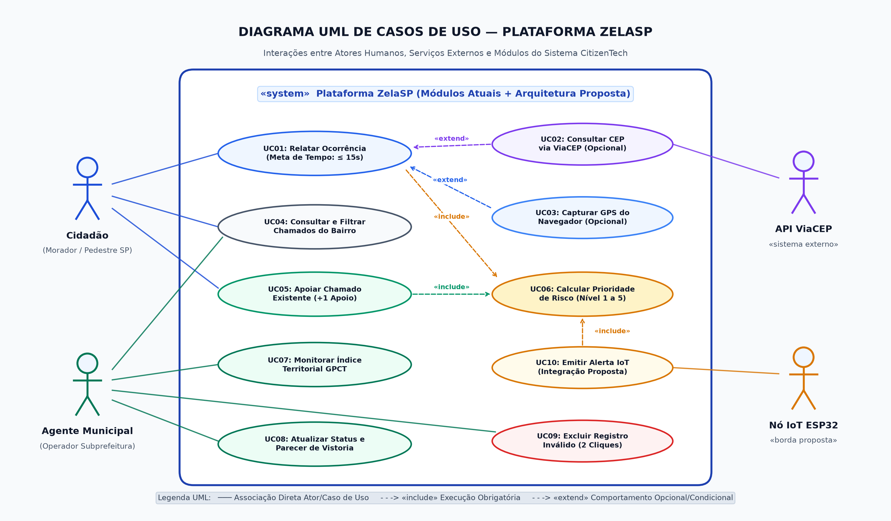

# ZelaSP — Software & Total Experience Design (Da Proposta ao Roadmap)

> **Global Solution 2026.2 · FIAP · Desafio CitizenTech**  
> **Disciplina:** Software & Total Experience Design  
> **Professor:** Henrique Cordeiro  
> **Turma:** 1ESPW — Engenharia de Software (1º Ano)  
> **Apresentação Executiva (Slides 16:9 em PDF):** [`Apresentacao_TX_Design_ZelaSP.pdf`](./Apresentacao_TX_Design_ZelaSP.pdf)  
> **Fonte Interativa dos Slides (HTML 16:9):** [`ZelaSP_Apresentacao_GS_2026.html`](./ZelaSP_Apresentacao_GS_2026.html)  
> **Protótipo Funcional no Ar (Vercel):** [https://zelasp-web.vercel.app/](https://zelasp-web.vercel.app/)  
> **Integrantes do Grupo:**
> * Gustavo Rezende Louro — RM570708
> * João Pedro Lagonegro Bosco e Silva — RM569444
> * João Pedro Maschion da Cruz Sá — RM570509
> * Lucas Henrique Alves da Silva — RM572216

---

## 📋 A Ficha da CitizenTech (Base Comum da Equipe)

| Campo da Ficha | Definição Oficial do Grupo (ZelaSP) |
| :--- | :--- |
| **Nome da CitizenTech** | **ZelaSP** — Protótipo Acadêmico de Zeladoria Cidadã e Organização para Triagem |
| **Cidade e Bairros de Atuação** | **São Paulo — SP**, com foco inicial em **Jabaquara, Vila Mariana, Saúde, Bela Vista, Mooca e Vila Mascote** (e seleção dinâmica de outros bairros da capital via consulta ViaCEP). |
| **Cidadão Beneficiado** | Pedestres, idosos, pessoas com deficiência (PcD), moradores e comerciantes locais que enfrentam riscos diários nas calçadas e vias, além dos agentes de triagem das Subprefeituras. |
| **Contexto, Diferencial Proposto e Limites** | O **SP156 já fornece protocolo e formas de acompanhamento** ([perguntas frequentes oficiais do SP156](https://prefeitura.sp.gov.br/web/inovacao/w/acesso_a_informacao/350229)), logo acompanhamento isoladamente não sustenta o diferencial do ZelaSP. O diferencial proposto combina **registro simples, apoio comunitário e organização das informações por risco**. O benefício para o cidadão e para a operação pública é uma **hipótese a validar**: o projeto ainda não demonstrou redução real do prazo de atendimento da Prefeitura (que depende também do processo público e de integração operacional ainda inexistente), e aspectos internos das subprefeituras (integração de sistemas, qualidade das informações, encaminhamento, equipes e recursos) são pontos a investigar, não diagnóstico comprovado pelo grupo. |
| **Como Funciona** | Voltado à meta de registro em até 15 segundos (a validar com testes de usabilidade), o morador digita o endereço ou consulta opcionalmente o CEP (**ViaCEP**), captura **GPS** opcional do navegador, seleciona foto em modo demonstrativo (funcionalidade futura de envio e localização por foto), escolhe uma das 6 categorias e sinaliza risco elétrico; vizinhos realizam apoio manual a ocorrências existentes (`PUT`) para incentivar a redução de relatos repetidos, e o perfil demonstrativo Prefeitura consulta dados compartilhados pela API e atualizados no carregamento, priorizados por política acadêmica de níveis 1 a 5 e indicador operacional **GPCT**. |
| **O que cada parte faz** | • **Web (`zelasp-web`):** Aplicação React + Vite + Tailwind com MockAPI, ViaCEP opcional, cache local apenas para consulta e seleção demonstrativa de foto.<br>• **Python (`zelasp-python`):** CLI independente com persistência JSON seguindo a mesma regra de prioridade (níveis 1 a 5).<br>• **Matemática / DPS (`zelasp-math`):** Estudo acadêmico independente de simulação 24h com limites, taxa não negativa `max(0, q(t))`, derivadas e integrais.<br>• **Edge/IoT (Wokwi):** Protótipo ESP32 independente para cenários de borda.<br>• **Arquitetura:** Web com MockAPI e ViaCEP; CLI Python com JSON; estudo matemático independente; integração entre módulos e IoT prevista na evolução.<br>• **Software & TX Design (esta entrega):** Escopo, requisitos (RF/RNF/RN), Diagrama UML de Casos de Uso, protótipo de média fidelidade, Heurísticas de Nielsen, Tom de Voz, Arquitetura TX (`CX/EX/UX/MX`) e Roadmap. |
| **Links Oficiais em Produção** | • **Deploy Web:** [https://zelasp-web.vercel.app/](https://zelasp-web.vercel.app/)<br>• **GitHub Web:** [https://github.com/ZelaSP/zelasp-web](https://github.com/ZelaSP/zelasp-web)<br>• **GitHub Python:** [https://github.com/ZelaSP/zelasp-python](https://github.com/ZelaSP/zelasp-python)<br>• **GitHub Math:** [https://github.com/ZelaSP/zelasp-math](https://github.com/ZelaSP/zelasp-math)<br>• **GitHub TX Design:** [https://github.com/ZelaSP/zelasp-tx-design](https://github.com/ZelaSP/zelasp-tx-design) |
| **Indicador de Impacto** | • **Tempo de relato:** Meta de registro em até 15 segundos, a validar com testes de usabilidade.<br>• **Duplicidade atual:** Apoio manual a ocorrências existentes para incentivar a redução de relatos repetidos.<br>• **Meta de duplicidade:** Meta futura de reduzir em 45% a parcela de chamados duplicados.<br>• **Resultado matemático:** Redução simulada de 38,5% do excedente sobre a base já deduplicada, após reforço de capacidade, nas hipóteses do exercício.<br>• **Foto e localização:** Funcionalidade futura: foto como evidência e apoio à localização da ocorrência; seleção demonstrativa na versão atual.<br>• **Arquitetura:** Web com MockAPI e ViaCEP; CLI Python com JSON; estudo matemático independente; integração entre módulos e IoT prevista na evolução. |
| **ODS Conectados** | • **ODS 11** (Cidades Sustentáveis — Metas 11.2 e 11.7): segurança e acessibilidade nas calçadas (fios, bueiros, entulho) para idosos, pedestres e PcDs.<br>• **ODS 9** (Inovação e Infraestrutura): integração de ViaCEP, API REST, modelagem matemática (GPCT) e IoT ESP32 na modernização da zeladoria urbana. |

---

## 📑 Estrutura da Apresentação Executiva (12 Slides · 100 Pontos)

O arquivo oficial para avaliação em PDF é [`Apresentacao_TX_Design_ZelaSP.pdf`](./Apresentacao_TX_Design_ZelaSP.pdf) (formato widescreen `16:9`, gerado a partir de [`ZelaSP_Apresentacao_GS_2026.html`](./ZelaSP_Apresentacao_GS_2026.html)). A estrutura cobre integralmente os 7 entregáveis obrigatórios da disciplina:

### 1. Capa e Identificação (Slide 01 · 5 pontos)
Apresenta o projeto **ZelaSP**, a turma **1ESPW**, o **Professor Henrique Cordeiro**, o nome completo e RM dos 4 integrantes, os **ODS 11 e 9** com legenda resumida e o link do protótipo ao vivo (`zelasp-web.vercel.app`).

---

### 2. Descrição do Problema (Slide 02 · 10 pontos)
* **O que acontece nas ruas:** Quatro cenários críticos que degradam a segurança e a mobilidade nos bairros prioritários (Jabaquara, Vila Mariana, Saúde, Bela Vista, Mooca e Vila Mascote), acompanhados das 6 categorias implementadas no formulário (`Fios e Cabos Rompidos/Soltos`, `Poda de Árvore com Risco Elétrico`, `Tampa de Bueiro Furtada/Quebrada`, `Buraco em Via ou Calçada`, `Descarte Irregular de Entulho` e `Carro Abandonado`):
  1. **Fiação elétrica rompida:** cabos possivelmente energizados expõem pedestres ao risco de choque;
  2. **Bueiro sem tampa:** risco de queda grave, especialmente para idosos e pessoas com deficiência;
  3. **Entulho na calçada:** obstrução força o pedestre a desviar para o asfalto entre veículos;
  4. **Carro abandonado:** pode acumular água parada e favorecer focos de dengue.
* **Quem é afetado:** Pedestres, idosos, pessoas com deficiência (PcD), moradores, comerciantes e equipes de triagem das Subprefeituras.
* **Dados, contexto informal e transparência de fontes:**
  * **Dado público (SMIT / Prefeitura de SP):** A rede **SP 156** (integrada ao **SGZ** nas **32 Subprefeituras**) registra cerca de **~2 milhões de demandas solucionadas por ano** e já fornece protocolo e formas de acompanhamento ([perguntas frequentes oficiais do SP156](https://prefeitura.sp.gov.br/web/inovacao/w/acesso_a_informacao/350229)).
  * **Dois relatos informais de contexto (sem medição realizada pelo grupo):**
    > Em duas conversas informais, pessoas relataram tempos aproximados de 30–40 minutos para registrar um pedido de remoção de árvore e de cerca de 10 minutos para solicitar uma lixeira para poste. Os relatos motivam investigar a dificuldade do registro por tipo de serviço. O grupo ainda não realizou uma comparação cronometrada entre o ZelaSP e o canal oficial.
  * **Meta própria de usabilidade e hipótese a validar:** O ZelaSP define a **meta de registro em até 15 segundos**, a validar com testes de usabilidade. O benefício para o cidadão e para a operação pública é uma hipótese a validar (sem redução comprovada do prazo de atendimento da Prefeitura, nem diagnóstico comprovado sobre qual é a maior dificuldade interna das subprefeituras).
  * **Cenário acadêmico simulado (`zelasp-math`):** Na simulação didática de 24 valores horários sem dados reais do SP156 ou testes com pessoas, adota-se o parâmetro hipotético de entrada `1,40` para ilustrar o acúmulo de relatos repetidos.

---

### 3. Escopo da Solução (Slide 03 · 10 pontos)

| ✓ DENTRO DO ESCOPO (O que o protótipo e a proposta ZelaSP cobrem) | × FORA DO ESCOPO / ROADMAP FUTURO |
| :--- | :--- |
| **01. Login demonstrativo + abertura 3D:** Entrada demonstrativa entre Cidadão e Prefeitura (sem validação de senha), com abertura educativa dos 4 problemas urbanos. | **01. Não executa obras físicas:** Não possui frota de caminhões ou asfalto; organiza triagem e despacho. |
| **02. Relato rápido (meta: ≤ 15s) com CEP/GPS opcional e foto demonstrativa:** Consulta opcional via **ViaCEP**, captura opcional de **GPS** do navegador e seleção demonstrativa de arquivo de foto (sem envio ou análise automática nesta versão). | **02. Não substitui atendimento emergencial:** Em acidente com vítima ou risco ativo, orienta acionar Bombeiros **193**, SAMU **192**, Defesa Civil **199** ou concessionária **Enel**. |
| **03. Apoio comunitário manual (+1):** Apoio demonstrativo a ocorrências existentes (`PUT`) para incentivar a redução de relatos repetidos (meta futura de −45% na duplicidade; deduplicação geográfica automática fica no roadmap). | **03. Não aplica multas nem faz autorização real:** Não substitui CET/190 e não coleta CPF/RG; autenticação real e upload/EXIF de fotos ficam no roadmap. |
| **04. Classificação uniforme de risco (níveis 1–5):** Política interna de triagem acadêmica idêntica em Python e Web (não representa classificação oficial da Prefeitura). | **04. Gravação offline e integração unificada no roadmap:** Versão atual tem cache de leitura apenas para consulta; fila offline, histórico fotográfico e integração Web/Python/Math/IoT compõem a evolução futura. |
| **05. Painel com GPCT operacional:** Filtros, ordenação (`prioridade desc`, `apoios desc`, resolvidos ao final), atualização de parecer/status e exclusão em 2 cliques. | — |

---

### 4. Requisitos Funcionais, Não Funcionais e Regras de Negócio (Slides 04 e 05 · 20 pontos)

Cada item explicita **Descrição**, **Classificação** (por que pertence àquela categoria) e **Justificativa** (conexão direta com o problema, escopo e pessoa usuária):

#### 4.1 Requisitos Funcionais (`RF01–RF06` — Slide 04)
| Código | Nome / Descrição | Classificação (Por que é RF?) | Justificativa (Por que é necessário?) |
| :--- | :--- | :--- | :--- |
| **RF01** | **Registrar ocorrência:** Categoria (6 tipos), endereço ou CEP, GPS opcional, risco elétrico, descrição e seleção demonstrativa de foto (`POST`). | Ação direta de entrada e persistência acionada pelo cidadão (envio e análise real de imagem ficam para versão futura). | Substitui formulários longos por fluxo enxuto focado nos riscos reais; requer rede para gravar. |
| **RF02** | **Autopreencher endereço (opcional):** ViaCEP valida CEP de 8 dígitos e completa logradouro e bairro quando informado. | Comportamento opcional de integração externa e transformação de entrada (`«extend»`). | Reduz erros de grafia sem impedir o cidadão de digitar o endereço manualmente. |
| **RF03** | **Apoiar ocorrência +1 (manual):** Somar apoio demonstrativo em chamado não resolvido (`PUT`). | Interação do cidadão que altera o contador do registro e recalcula prioridade da base. | Incentiva a redução de relatos repetidos e quantifica demanda coletiva (deduplicação por GPS fica no roadmap). |
| **RF04** | **Consultar e filtrar:** Busca textual, filtros por bairro/status e ordenação (prioridade desc, apoios desc, resolvidos ao fim) via `GET`. | Define consulta, filtragem e ordenação em dados compartilhados pela API e atualizados no carregamento. | O cidadão encontra relatos da rua; a Prefeitura vê primeiro emergências e casos mais apoiados. |
| **RF05** | **Monitorar índice GPCT operacional:** Contar chamados não resolvidos de nível ≥4 no painel. | Processa o conjunto monitorado carregado e exibe estado (`<2` estável, `2–3` atenção, `≥4` contingência). | Aponta saturação operacional no painel; integração preditiva de Matemática fica no roadmap. |
| **RF06** | **Gerir status e registros:** Atualizar status/parecer (`PUT`) e excluir inválidos em 2 cliques (`DELETE`) no perfil demonstrativo Prefeitura. | Modela operações administrativas no protótipo acadêmico (autorização real no servidor fica no roadmap). | Dá transparência ao parecer da Prefeitura e mantém a fila pública íntegra. |

#### 4.2 Requisitos Não Funcionais (`RNF01–RNF04` — Slide 05)
| Código | Descrição | Classificação (Por que é RNF?) | Justificativa (Por que é necessário?) |
| :--- | :--- | :--- | :--- |
| **RNF01** | **Meta de registro em até 15 segundos (a validar com testes de usabilidade).** | Usabilidade e eficiência — meta de tempo e esforço operacional a validar. | Orienta um fluxo enxuto para concluir o relato na calçada sem desistência. |
| **RNF02** | **Layout mobile-first responsivo (360–1920px) com meta de conformidade WCAG AA e alvos ≥44px.** | Acessibilidade e ergonomia — metas de qualidade da interface a validar em testes. | Visa garantir leitura sob luz solar e uso acessível por todas as idades. |
| **RNF03** | **API em nuvem (MockAPI) com cache local apenas para consulta (`Dados locais` / `Sem conexão — consulta em cache`).** | Confiabilidade e clareza de conectividade — criação, apoio e edição dependem de rede. | Permite leitura em cache se o sinal cair, sem simular fila de gravação offline (prevista na evolução). |
| **RNF04** | **Dados compartilhados pela API e atualizados no carregamento; troca de perfil na mesma aba reaproveita estado.** | Desempenho e sincronia de estado — meta de latência na carga e ViaCEP opcional. | Esclarece que a atualização ocorre no carregamento (sem sincronização automática entre dispositivos). |

#### 4.3 Regras de Negócio (`RN01–RN04` — Slide 05)
| Código | Descrição | Classificação (Por que é RN?) | Justificativa (Por que é necessário?) |
| :--- | :--- | :--- | :--- |
| **RN01** | **Risco elétrico marcado resulta em nível 5 em todas as categorias; bueiro sem tampa resulta em nível 5.** | Política interna de triagem acadêmica (não representa classificação oficial pública). | Padroniza proteção à vida em Python e Web; demais bases sem risco elétrico: Buraco `4`, Fios `3`, Poda `3`, Entulho `2`, Carro `1`. |
| **RN02** | **10 ou mais apoios acrescentam um único nível à prioridade-base, com teto 5 (recalculado da base).** | Regra matemática determinística uniforme (`main.py` e `riskCalculator.js`). | Valoriza validação coletiva sem multiplicar níveis indefinidamente após o décimo apoio. |
| **RN03** | **GPCT operacional (<2 estável; 2–3 atenção; ≥4 contingência) distinto da simulação matemática.** | Regra operacional do painel baseada no total não resolvido de nível ≥4. | Separa a regra simples do painel Web do modelo temporal estudado em Matemática para evolução futura. |
| **RN04** | **Ocorrências `RESOLVIDO` não recebem apoio; ações de gestão pertencem ao perfil demonstrativo Prefeitura.** | Integridade de fluxo e alçada demonstrativa (autorização real no servidor permanece no roadmap). | Impede apoio em chamados encerrados e protege visualmente o parecer técnico da Prefeitura. |

---

### 5. Diagrama UML de Casos de Uso e Contextualização (Slide 06 · 15 pontos)



* **Contextualização dos 4 Atores (Slide 06):**
  1. **Cidadão (`HUMANO`):** Executa `UC01` (relatar com meta ≤ 15s), `UC02` (ViaCEP via `«extend»` opcional), `UC03` (GPS via `«extend»` opcional), `UC04` (consultar/filtrar chamados) e `UC05` (apoiar +1). **Objetivo:** resolver riscos da sua rua rapidamente e acompanhar o andamento. *(Uso de metadados GPS da foto para sugerir local e envio real da imagem ficam no roadmap; nesta versão, a seleção de foto é demonstrativa — veja referência técnica de limitação EXIF em [`ExifInterface — getLatLong`](https://developer.android.com/reference/androidx/exifinterface/media/ExifInterface#getLatLong())).*
  2. **Agente Municipal (`HUMANO`):** Executa `UC04` (consultar fila), `UC07` (monitorar GPCT operacional), `UC08` (atualizar status/parecer) e `UC09` (excluir inválido em 2 cliques) via perfil demonstrativo Prefeitura. **Objetivo:** despachar equipes priorizando níveis 5 e 4.
  3. **API ViaCEP (`EXTERNO`):** Serviço REST acionado opcionalmente em `UC02` (`«extend»` de `UC01`), pois o endereço também pode ser digitado manualmente.
  4. **Nó IoT ESP32 (`BORDA PROPOSTA`):** Protótipo Wokwi independente modelado em `UC10` na arquitetura proposta de integração futura com Web e GPCT (`UC06`).

---

### 6. Protótipo de Média Fidelidade, Heurísticas, Tom de Voz e Arquitetura TX (Slides 07, 08 e 09 · 25 pontos)

* **Slide 07 — Fluxo Ponta a Ponta em Média Fidelidade (Pins ①–⑨):**
  1. **Tela 01 · Novo Relato (`Cidadão`):** Seleção entre os **6 botões de categorias urbanas** (`Fios e Cabos Rompidos/Soltos`, `Poda com Risco Elétrico`, `Tampa de Bueiro Furtada`, `Buraco em Via ou Calçada`, `Descarte de Entulho` e `Carro Abandonado`), campo opcional `CEP` + `Buscar CEP`, `Usar meu GPS` opcional, seletor `Foto do local — demonstração` (com aviso de funcionalidade prevista para próxima versão), caixa preventiva (`Risco de choque ou faíscas? → Nível 5`) e `Publicar Relato`.
  2. **Tela 02 · Feed Comunitário (`Cidadão`):** Filtro `Todos os bairros` e busca com ação `Limpar`, cards ordenados por prioridade e desempate por apoios (`SP-2026-101 · 14 apoios · Em execução` com `Também vi na rua · Apoiar (14)`, e `SP-2026-105 · 5 apoios · Aberto`), bloqueio de apoio em `RESOLVIDO` e toast de sucesso.
  3. **Tela 03 · Painel Gestor (`Prefeitura`):** Contadores (`05 Pendentes na fila`, `04 Chamados de risco alto/crítico` sobre os dados iniciais), faixa `GPCT · CONTINGÊNCIA ATIVADA`, filtros e ações `Despachar / Status`, `Parecer da Prefeitura` e exclusão em 2 etapas (`Confirmar / Não`).
* **Slide 08 — Heurísticas de Nielsen e Tom de Voz (com strings literais do código):**
  * **H1 (Visibilidade):** selos `Nuvem` (após leitura remota) / `Sem conexão — consulta em cache` / `Dados locais`, retorno ViaCEP, badges `ABERTO → RESOLVIDO`, faixa GPCT e toasts de erro preservando campos/botões.
  * **H2 (Mundo Real):** abertura 3D com os 4 cenários urbanos e categorias em linguagem cotidiana.
  * **H3 (Controle e Liberdade):** botão `Pular` na abertura, `Limpar` nos filtros e troca na mesma aba `Cidadão ↔ Prefeitura`.
  * **H5 (Prevenção de Erros):** validação de 8 dígitos no CEP, apoio manual contra duplicidade, trava em `RESOLVIDO`, alerta 193/199 e confirmação dupla `Confirmar / Não`.
  * **H6 (Reconhecimento) & H8 (Design Minimalista):** botões rápidos de bairro prioritário, hierarquia limpa e cor vermelha reservada a risco extremo/exclusão.
  * **Tom de Voz:** Cívico, empático, direto, transparente e preventivo — com trechos literais de [`Header.jsx`](https://github.com/ZelaSP/zelasp-web/blob/main/src/components/Header.jsx), [`App.jsx`](https://github.com/ZelaSP/zelasp-web/blob/main/src/App.jsx) e [`viaCepService.js`](https://github.com/ZelaSP/zelasp-web/blob/main/src/services/viaCepService.js).
* **Slide 09 — Arquitetura Total Experience (`CX / EX / UX / MX`):** Diferencia claramente os **módulos atuais** (Web com MockAPI/ViaCEP, CLI Python com JSON, estudo matemático independente em `zelasp-math` e nó Wokwi independente) da **arquitetura proposta de integração** entre módulos, IoT e localização por foto na evolução futura.

---

### 7. Modelagem GPCT, Roadmap de Evolução e Fechamento ODS (Slides 10, 11 e 12 · 15 pontos)

* **Slide 10 — Os Dois Mecanismos GPCT (`Gatilho Preditivo de Contingência Territorial`):**
  * **Painel Web atual ([`riskCalculator.js`](https://github.com/ZelaSP/zelasp-web/blob/main/src/utils/riskCalculator.js)):** Indicador operacional baseado no total de chamados não resolvidos de nível ≥4: menos de 2 = estável; de 2 a 3 = atenção; a partir de 4 = contingência. A contagem atual considera o conjunto monitorado.
  * **Estudo de Matemática (`zelasp-math`):** Simulação acadêmica de um possível gatilho temporal, baseada em taxa de chegada não negativa (`max(0, q(t))`) e variação `q'(t)`, obtendo redução simulada de **38,5%** do excedente sobre a base já deduplicada (`42,41 → 26,08`), após reforço de capacidade, nas hipóteses do exercício. Integração preditiva com o painel é evolução futura.
* **Slide 11 — Roadmap de Evolução em 4 Fases (12 Meses):**
  1. **Meses 1–2 · Fase 01:** Validar em campo com moradores, idosos e PcDs as metas de **registro em até 15 segundos** e conformidade **WCAG AA** (`META · SUS ≥ 85`, `Conclusão > 95%`).
  2. **Meses 3–4 · Fase 02:** Evoluir cache de leitura para fila offline com sincronização, implementar upload real de fotos com sugestão de local via GPS EXIF + confirmação do cidadão, autenticação real e deduplicação automática por proximidade (`META · −90% relatos incompletos`).
  3. **Meses 5–6 · Fase 03:** Integrar módulos atuais (Web, Python e estudo GPCT) com telemetria IoT ESP32 em piloto assistido (`META · −60% tempo de triagem Nível 5`).
  4. **Meses 7–12 · Fase 04:** Interoperabilidade via API com SGZ/SP 156 e histórico fotográfico antes/depois (`META · −45% na parcela de chamados duplicados`).
* **Slide 12 — Links de Produção e ODS 11 & 9:** Consolida os links do deploy e repositórios ao lado da explicação explícita de contribuição do ZelaSP às metas dos **ODS 11 e 9**.

---

## 🛠️ Como Regenerar o Diagrama UML e o PDF

1. **Regenerar o Diagrama UML (`assets/diagrama_casos_de_uso.png`):**
   ```bash
   python gerar_diagramas.py
   ```
2. **Exportar o PDF 16:9 a partir de `ZelaSP_Apresentacao_GS_2026.html`:**
   Abra [`ZelaSP_Apresentacao_GS_2026.html`](./ZelaSP_Apresentacao_GS_2026.html) no navegador e utilize `↗ Imprimir / PDF` (ou Google Chrome Headless com suporte à regra `@page { size: 13.333in 7.5in; margin: 0; }`).
