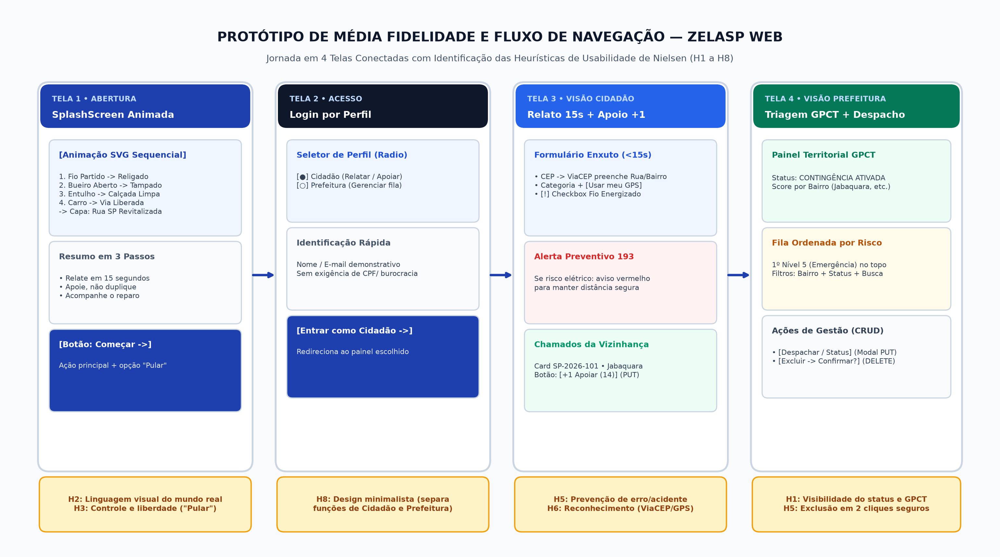
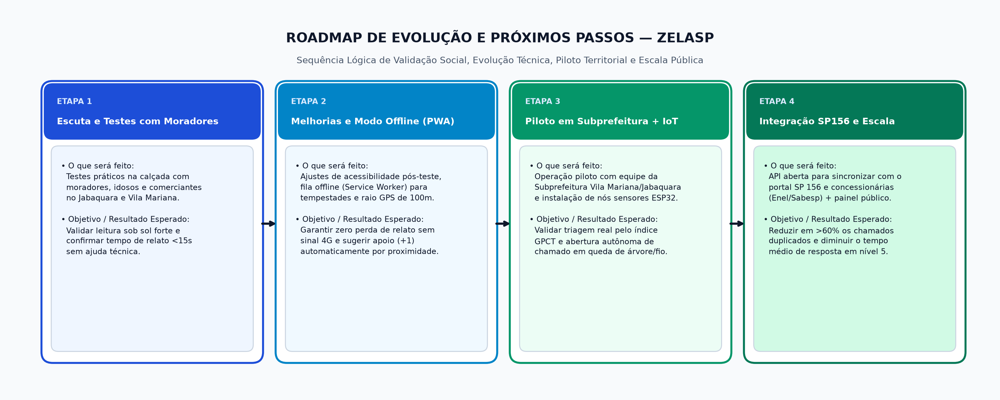

# 🏙️ ZelaSP — Software & Total Experience Design (Da Proposta ao Roadmap)

> **Global Solution 2026.2 · FIAP · Desafio CitizenTech**  
> **Disciplina:** Software & Total Experience Design  
> **Professor:** Henrique Cordeiro  
> **Turma:** 1ESPW — Engenharia de Software (1º Ano)  
> **Apresentação Executiva (Slides 16:9 em PDF):** [`Apresentacao_TX_Design_ZelaSP.pdf`](./Apresentacao_TX_Design_ZelaSP.pdf)  
> **Protótipo Navegável no Ar (Vercel):** [https://zelasp-web.vercel.app/](https://zelasp-web.vercel.app/)  
> **Integrantes do Grupo:**
> * Gustavo Rezende Louro — RM570708
> * João Pedro Lagonegro Bosco e Silva — RM569444
> * João Pedro Maschion da Cruz Sá — RM570509
> * Lucas Henrique Alves da Silva — RM572216

---

## 📋 A Ficha da CitizenTech (Base Comum da Equipe)

| Campo da Ficha | Definição Oficial do Grupo (ZelaSP) |
| :--- | :--- |
| **Nome da CitizenTech** | **ZelaSP** — Zeladoria Cidadã Inteligente e Monitoramento Urbano |
| **Cidade e Bairros de Atuação** | **São Paulo — SP**, com foco inicial em **Jabaquara, Vila Mariana, Saúde, Bela Vista, Mooca e Vila Mascote**. |
| **Cidadão Beneficiado** | Pedestres, idosos, pessoas com deficiência (PcD), moradores e comerciantes locais que enfrentam riscos diários nas calçadas e vias, além dos operadores de triagem das Subprefeituras. |
| **Problema em uma Frase** | O canal atual de zeladoria (SP 156) é burocrático e lento (5 a 8 min por chamado), gera dezenas de protocolos duplicados para o mesmo problema em dias de chuva e não oferece transparência sobre o reparo. |
| **Como Funciona** | Em menos de 15 segundos, o morador informa o CEP (ViaCEP) ou GPS e relata fios caídos, bueiros abertos, entulho na calçada ou carros abandonados; vizinhos somam apoio (**Apoiar +1**) sem duplicar chamados, e a Prefeitura despacha equipes priorizadas por risco à vida (Níveis 1 a 5 e índice territorial **GPCT**). |
| **O que cada parte faz** | • **Python:** Motor lógico de classificação de risco e deduplicação CLI. • **Matemática (DPS):** Modelagem de limites, derivadas e integrais do índice GPCT. • **Edge/IoT (Wokwi):** Nó sensor ESP32 autônomo em postes críticos. • **Front-end & WebDev:** Aplicação React + Vite + Tailwind integrada ao ViaCEP e MockAPI. • **Software & TX Design:** Engenharia de requisitos (RF/RNF/RN), UML, Heurísticas de Nielsen, Tom de Voz e Roadmap. • **Storytelling:** Videopitch de 3 min e posicionamento de Arquétipo de Marca. |
| **Links Oficiais** | • **Deploy Web:** [https://zelasp-web.vercel.app/](https://zelasp-web.vercel.app/) • **GitHub Web:** [https://github.com/ZelaSP/zelasp-web](https://github.com/ZelaSP/zelasp-web) • **GitHub Python:** [https://github.com/ZelaSP/zelasp-python](https://github.com/ZelaSP/zelasp-python) • **GitHub Math:** [https://github.com/ZelaSP/zelasp-math](https://github.com/ZelaSP/zelasp-math) |
| **Indicador de Impacto** | Redução do tempo de relato para **<15 segundos**, eliminação de **>60% dos chamados duplicados** no mesmo quarteirão e priorização imediata de emergências Nível 5. |
| **ODS Conectados** | **ODS 11** (Cidades e Comunidades Sustentáveis — Meta 11.7 e 11.b) e **ODS 9** (Indústria, Inovação e Infraestrutura). |

---

## 📑 Estrutura dos 7 Entregáveis Obrigatórios (100 Pontos)

### 1. Capa e Identificação (Slide 1 · 5 pontos)
Apresenta o projeto **ZelaSP**, a turma **1ESPW**, o **Professor Henrique Cordeiro**, o nome completo e RM dos 4 integrantes, os ODS conectados e o link do protótipo funcional.

---

### 2. Descrição do Problema (Slide 2 · 10 pontos)
* **O que acontece no território:** No caminho diário pelos bairros de Jabaquara, Vila Mariana, Saúde, Bela Vista, Mooca e Vila Mascote, quatro ocorrências críticas degradam a segurança urbana:
  1. **Fiação elétrica e cabos rompidos:** galhos e caminhões rompem fios que permanecem energizados na calçada;
  2. **Bueiros abertos sem tampa:** furto ou quebra de grelhas deixando buracos abertos na via e no passeio;
  3. **Descarte irregular de entulho:** restos de obra obstruindo a passagem de pedestres;
  4. **Carros abandonados:** carcaças enferrujadas acumulando água parada (foco de dengue) e ocupando a via pública.
* **Quem é afetado:** Pedestres, idosos e pessoas com deficiência (forçados a caminhar no asfalto), moradores/comerciantes locais e equipes de triagem das Subprefeituras.
* **Evidências e Gargalos do SP 156:** O portal municipal recebe mais de **450 mil solicitações anuais** de zeladoria, mas exige de **5 a 8 minutos** para abrir um chamado, gera dezenas de protocolos repetidos para o mesmo ponto em dias de tempestade e funciona como uma "caixa-preta" sem feedback visual claro.

---

### 3. Escopo da Solução (Slide 3 · 10 pontos)

| ✓ O que ESTÁ DENTRO do Escopo (Contemplado) | ✕ O que FICA FORA do Escopo (Não Contemplado) |
| :--- | :--- |
| **1. Abertura Educativa e Login por Perfil:** Animação sequencial dos 4 problemas urbanos e escolha de visão (**Cidadão** vs. **Prefeitura**). | **1. Execução Física de Obras:** O ZelaSP não possui caminhões próprios, não poda árvores fisicamente nem asfalta ruas. |
| **2. Relato Cidadão em <15s:** Autopreenchimento de rua e bairro por CEP (**API ViaCEP**), coordenadas via **GPS** e anexo de foto. | **2. Substituição da Concessionária ou Bombeiros (193):** Não opera a rede da Enel nem substitui o resgate de emergência (orienta ligar 193 em risco ativo). |
| **3. Deduplicação por Apoio Comunitário (+1):** Botão `Apoiar` (`PUT`) que soma peso ao chamado de um vizinho sem duplicar protocolo. | **3. Multas de Trânsito ou Policiamento:** Não emite autuações da CET/GCM nem realiza guinchamento sem validação pública. |
| **4. Motor de Prioridade (Níveis 1 a 5):** Classificação automática cruzando categoria, risco elétrico e volume de apoios. | **4. Coleta de Dados Sensíveis (LGPD):** Não exige CPF, RG, biometria ou pagamento de taxas pelo morador. |
| **5. Painel da Prefeitura com GPCT e CRUD:** Monitoramento por bairro, atualização de status/parecer técnico (`PUT`) e exclusão em 2 cliques (`DELETE`). | **5. Demandas Fora de Zeladoria:** Não atende ocorrências policiais (190), consultas médicas ou impostos municipais (IPTU). |

---

### 4. Requisitos Funcionais (RF), Não Funcionais (RNF) e Regras de Negócio (RN) (Slides 4 e 5 · 20 pontos)

#### 4.1 Requisitos Funcionais (RF — O que o sistema deve fazer)
| Código | Descrição | Classificação (Por que é RF?) | Justificativa (Por que é necessário?) |
| :--- | :--- | :--- | :--- |
| **RF01** | Permitir ao cidadão registrar uma ocorrência informando CEP, categoria (fio, bueiro, entulho, carro ou buraco), descrição, flag de risco elétrico e foto. | Define uma funcionalidade direta de entrada e criação de dados pelo usuário (`POST`). | Substitui o formulário longo do SP 156 por um fluxo enxuto focado nos problemas reais observados nos bairros. |
| **RF02** | Consultar automaticamente a API pública ViaCEP ao digitar 8 dígitos de CEP e preencher logradouro e bairro no formulário (com opção de GPS). | Comportamento funcional de integração externa e autopreenchimento. | Na calçada e com pressa, o cidadão muitas vezes não sabe o nome exato da rua; evita erros de digitação. |
| **RF03** | Permitir que moradores somem apoio comunitário (**Apoiar +1** via `PUT`) a um chamado existente no bairro sem criar novo protocolo. | Ação interativa de atualização acionada pelo ator Cidadão. | Elimina a explosão de chamados repetidos no mesmo quarteirão durante temporais, medindo o impacto coletivo. |
| **RF04** | Filtrar, buscar textualmente e ordenar a fila de ocorrências por bairro, status e nível de severidade (Nível 5 no topo). | Função de consulta, processamento e ordenação de listas (`GET`). | Permite ao morador achar chamados da sua rua rapidamente e à Prefeitura enxergar primeiro as emergências. |
| **RF05** | Exibir no Painel da Prefeitura o cálculo em tempo real do índice territorial **GPCT** (*Estável*, *Atenção Operacional* ou *Contingência Ativada*). | Funcionalidade analítica de suporte à decisão para o gestor municipal. | Traduz o modelo matemático em alerta visual imediato quando um bairro acumula ocorrências críticas. |
| **RF06** | Permitir ao operador da Prefeitura atualizar o status (`EM_VISTORIA`, `EM_EXECUCAO`, `RESOLVIDO`) com parecer técnico e excluir registros inválidos. | Operações administrativas de atualização (`PUT`) e remoção (`DELETE`). | Dá transparência ao cidadão sobre o andamento do reparo e permite limpar trotes da fila pública. |

#### 4.2 Requisitos Não Funcionais (RNF — Qualidade ou condição de funcionamento)
| Código | Descrição | Classificação (Por que é RNF?) | Justificativa (Por que é necessário?) |
| :--- | :--- | :--- | :--- |
| **RNF01** | O cadastro completo de uma ocorrência pelo cidadão deve exigir no máximo 4 interações e ser concluído em até 15 segundos. | Meta mensurável de usabilidade e tempo de operação, não uma função isolada. | Garante que o morador consiga relatar caminhando na rua sem abandonar o formulário no meio. |
| **RNF02** | Adotar paleta clara de alto contraste (WCAG AA), suporte a `prefers-reduced-motion` e layout responsivo *Mobile-First*. | Restrição visual, ergonômica e de acessibilidade da interface. | O sistema é utilizado no celular sob sol forte nas calçadas de São Paulo por cidadãos de todas as idades. |
| **RNF03** | Sincronizar dados com API REST em nuvem (MockAPI) mantendo fallback automático em `localStorage` em caso de queda de rede. | Atributo de resiliência, disponibilidade e tolerância a falhas. | Durante tempestades, o sinal 4G oscila; o morador não pode perder o relato preenchido. |
| **RNF04** | O carregamento inicial da lista e o retorno da consulta de CEP (ViaCEP) devem responder em menos de 2 segundos. | Restrição de desempenho e tempo de resposta HTTP. | Evita que o usuário precise digitar o endereço manualmente por lentidão na busca automática. |

#### 4.3 Regras de Negócio (RN — Condições que o processo precisa respeitar)
| Código | Descrição | Classificação (Por que é RN?) | Justificativa (Por que é necessário?) |
| :--- | :--- | :--- | :--- |
| **RN01** | Chamados de *Fios Rompidos* com risco elétrico ativo ou *Tampa de Bueiro Furtada* recebem obrigatoriamente **Prioridade Máxima (Nível 5)**. | Regra de domínio que governa o cálculo de criticidade do processo. | Risco iminente de choque elétrico ou queda grave exige despacho imediato antes de demandas estéticas. |
| **RN02** | Quando um chamado atinge **10 ou mais apoios comunitários**, seu nível de prioridade sobe automaticamente em +1 ponto (até o teto 5). | Condição matemática de escalonamento por pressão social. | Recompensa o uso do botão *Apoiar (+1)* e prioriza problemas que impactam dezenas de moradores. |
| **RN03** | O índice **GPCT** muda para *Atenção Operacional* com ≥2 chamados críticos abertos (Nível ≥4) e para *Contingência Ativada* com ≥4. | Gatilho operacional fundamentado na modelagem matemática (DPS). | Alerta a Subprefeitura antes que a fila do bairro entre em colapso durante eventos extremos. |
| **RN04** | Apenas o perfil **Prefeitura** pode alterar status de vistoria ou excluir registros (com confirmação dupla), sendo vedado ao perfil Cidadão. | Política de governança, alçada e controle de acesso entre perfis. | Impede que terceiros encerrem indevidamente ou apaguem chamados reais abertos pela vizinhança. |

---

### 5. Diagrama de Caso de Uso e Contextualização (Slides 6 e 7 · 15 pontos)

* **Contextualização dos 4 Atores:**
  1. **Cidadão (Ator Primário Humano):** Morador ou pedestre que relata ocorrências (`UC01`), usa o GPS (`UC03`), consulta chamados do bairro (`UC04`) e soma apoio (`UC05`) para ver sua rua segura em <15s.
  2. **Agente Municipal (Ator Primário Humano):** Operador da Subprefeitura que filtra a fila (`UC04`), monitora o índice `GPCT` (`UC07`), atualiza status/vistoria (`UC08`) e exclui registros inválidos (`UC09`).
  3. **API ViaCEP (Ator Secundário Externo):** Serviço externo acionado via `<<include>>` no `UC02` para retornar rua e bairro a partir do CEP.
  4. **Nó IoT ESP32 (Ator Secundário de Borda):** Dispositivo físico simulado que executa o `UC10` (alerta automático de queda/fiação em poste crítico), incluindo o cálculo de prioridade máxima (`UC06`).

---

### 6. Protótipo de Média Fidelidade, Heurísticas e Tom de Voz (Slides 8 e 9 · 25 pontos)

* **Heurísticas de Usabilidade de Nielsen Aplicadas:**
  * **H1 — Visibilidade do Status do Sistema:** Selo `MockAPI Conectada`, aviso `Buscando endereço...` no CEP, badges coloridos (`ABERTO`, `EM_VISTORIA`, `EM_EXECUCAO`, `RESOLVIDO`) e notificações *Toast*.
  * **H2 — Correspondência com o Mundo Real:** Animação de abertura mostrando fio, bueiro, entulho e carro abandonado, além de termos compreensíveis pelo cidadão comum.
  * **H3 — Controle e Liberdade do Usuário:** Botão `Pular` na abertura, `Limpar filtros` na listagem e alternância livre entre os perfis Cidadão e Prefeitura.
  * **H5 — Prevenção de Erros e Acidentes:** Alerta vermelho imediato ao marcar fiação energizada (orientando distância e ligar 193) e confirmação em 2 cliques (`Excluir -> Confirmar?`) na Prefeitura.
  * **H6 & H8 — Reconhecimento em vez de Memorização e Design Minimalista:** Autopreenchimento via CEP/GPS e separação entre a tela limpa do Cidadão e os controles técnicos da Prefeitura.
* **Tom de Voz:** Cívico, direto, humano e preventivo, sem jargões burocráticos.

---

### 7. Roadmap: Próximos Passos da Solução (Slide 10 · 15 pontos)

